# 千问办公绿皮书


每个人都能照着做的办公手册

## 目录

- [01 今天要交的东西](#task-1) — 先选一件能核对的小事
- [02 一张工作单](#task-2) — 目标 材料 交付和核对方法
- [03 写出可以修改的文档](#task-3) — 通知 说明与周报
- [04 让一张表把情况说清楚](#task-4) — 活动报名数据 附完整答案
- [05 把流程讲给别人听](#task-5) — 从大纲到可以播放的演示
- [06 查资料时把证据留下](#task-6) — 场地比较和文件问答
- [07 整理经得起追问的记录](#task-7) — 分清原话 意见和待办
- [08 做出可以预览的宣传内容](#task-8) — 图片 短片和活动网页
- [09 同一件事下次少说一点](#task-9) — 保存公告方法与协作偏好
- [10 从外部工具取资料](#task-10) — 连接器 电脑操作和权限
- [11 让重复小事按时开始](#task-11) — 定时简报和聊天入口
- [12 换成你的岗位](#task-12) — 四张可以动手的原创任务卡
- [13 卡住时按顺序排查](#task-13) — 先找原因 再决定如何处理
- [14 七个二十分钟小挑战](#task-14) — 任选一项 带走一份小成果
- [15 登录与常用词](#task-15) — 三种入口 文件格式和官方资料

**中国版 QwenWork · 原创教学版 · 资料核查日 2026 年 10 月 23 日**

你不需要会编程，也不需要先背一遍 AI 术语。拿出一件今天真的要完成的小事：发一份通知、核对一张表、准备几页汇报，找到相应章节，先照着做出第一份可以检查的成果。

这本书教的是一种工作方法：把资料给全，把要求说清，把结果核实。千问办公可以协助生成、整理和执行，但“已经生成”与“可以交出去”之间，还需要你检查事实、数字、文件和接收对象。

**适用范围。** 本书中的千问办公指 [qwenwork.cn](https://qwenwork.cn/) 提供的 QwenWork 中国版。千问聊天 App、千问模型和面向开发者的模型接口，属于不同的产品或使用方式，不能直接套用本书的入口、权限和费用说明。

**怎么读。** 赶时间就从任务导航进入；完全没用过，就先看“今天要交的东西”和“一张工作单”，再打开“登录与常用词”。正文里带灰底的文字可以复制到千问办公，复制前请替换方括号里的内容。

**三种内容标记。**“官方说明”表示有相邻链接可查的产品信息；“本书方法”是便于普通人操作的建议；“模拟练习”是专为教学编写的数据和情境。练习中的人物、商店、活动与业绩不指向真实主体，也不代表我们已经在千问办公账号中完成了这些操作。

**原创与来源。** 本书以日常交付物独立组织内容，案例、提示词、练习、教学配图和核对答案均为本书编写。产品事实依据千问办公官网、官方帮助文档与官方学习站；书末附按用途整理的来源入口。本书不是阿里巴巴或钉钉官方出版物。

**版本提醒。** 产品会更新。找不到某个按钮时，先核对自己用的是网页端、桌面端还是钉钉入口，以及个人空间还是企业空间。价格、赠送积分、模型名单和文件上限请看当前页面；本书不把限时活动写成长期承诺。

### 先挑一件今天能做完的事

| 你眼前的事情 | 可以先读 | 最终带走什么 |
| --- | --- | --- |
| 我不知该怎样开口 | 一张工作单 | 一条说得清、可检查的任务要求 |
| 我要发一份通知 | 写出可以直接修改的文档 | 文字草稿与可编辑文件 |
| 我看着表格没头绪 | 让一张表把情况说清楚 | 核对过的数字与图表 |
| 我要向别人讲明白 | 把数字讲给人听 | 有顺序、看得清的演示文稿 |
| 我要查资料做判断 | 查资料时把证据留下 | 来源、结论和待核实事项 |
| 留言和访谈太零碎 | 把原话整理成可追问的记录 | 分清事实、意见和待办的记录 |
| 我想做海报和活动页 | 做出可以预览的宣传内容 | 海报、短片或网页草稿 |
| 同样的事每周都要做 | 同一件事下次少说一点 | 可复用的方法和材料 |
| 执行卡住或者结果不对 | 卡住时按顺序排查 | 故障位置和可提交的问题说明 |

所有章节的练习耗时都是学习安排建议，不是产品速度测试。复杂文件、联网调研和多媒体生成可能等待更久。


<a id="task-1"></a>

## 01 今天要交的东西

第一次使用千问办公，最合适的任务往往很普通：把几条事实写成通知，把一张小表算清楚，把一段长话变成别人能读懂的说明。先做完一件小事，你就会知道材料要给多少、指令怎样说、结果应该怎么查。

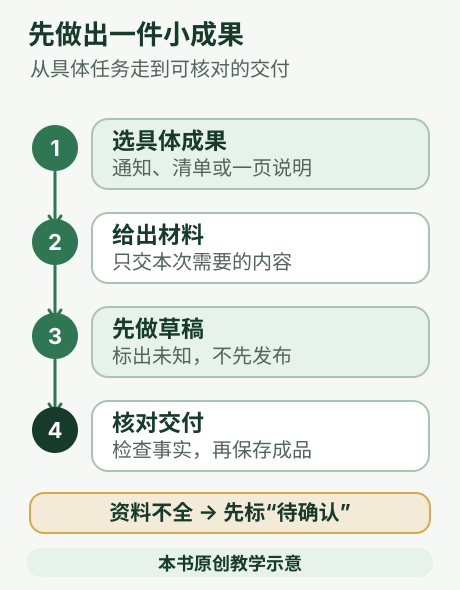

### 什么叫完成

假设你负责一场社区读书会。“帮我做宣传”听起来像任务，实际还差很多信息：是写群通知、做海报，还是做报名网页？给谁看？时间地点确定了吗？希望别人看完做什么？

可以把它缩成一件能看见结果的事：“把下面五条信息写成一份不超过 180 字的群通知，先交草稿。”这个任务有材料、有对象、有长度、有成果；对错也容易查。

千问办公官方介绍列出了文档、表格、演示文稿、网页和多媒体等交付方向。选择任务时，请从要拿到的东西出发；不要因为它能做很多事，就把所有事情塞进同一条指令。[官方产品介绍](https://docs.qwenwork.cn/product-introduction)

### 用一张小清单判断任务是否合适

**资料拿得到。** 总结一份文件前，你能提供文件；分析订单前，你能提供订单表。只有一个链接时，先让它确认能否读取；读不到就提供允许使用的正文或附件。不能把“你应该知道”当成资料。

**范围圈得住。** 先整理本周三条进展，比“重建整个公司的工作体系”容易验收。先做一个活动介绍页，比“做一个像大型平台一样完整的系统”更适合初次尝试。

**结果查得了。** 通知能逐字核对时间地点；表格能抽算合计；网页能自己打开；文件能下载和编辑。“更专业”“更高级”没有标准，可以换成“每段不超过四行”“保留原金额”“列出三个有来源的发现”。

**操作可收回。** 先生成副本和草稿，再考虑覆盖、发送和发布。练习阶段选择不需要客户资料、付款或删文件的任务即可。这是本书给初学者的安排，不代表产品必须走同样流程。

### 一个从头到尾都够小的任务

下面是本书原创模拟材料，你可以直接复制练习：

```text
请把下面信息写成一份给居民看的读书会群通知，150至180字。
活动：周末交换阅读经验。
时间：2026年11月7日星期六，上午10点至11点半。
地点：青禾社区活动室。
对象：对阅读感兴趣的成年人。
准备：自带一本愿意分享的书。
这是模拟练习，不是真实活动。不要添加收费、人数上限、报名链接或主办单位承诺。
用普通话写清参加者要做什么。只给草稿，不对外发送。
```

看结果时，不必先评价文采。先划出六个信息：活动、日期、起止时间、地点、对象、准备事项。任何一项写错都需要改；凭空出现的“名额有限”“现场赠礼”也需要删。检查通过后，再调整语气和长度。

### 选错任务会出现什么

“帮我把业务做起来”范围太大，AI 可能写出一份看起来完整却无法执行的方案。把它换成“根据这 12 行模拟订单，分别算出三个月净收入”就能检查。

“帮我做一个真实客户分析”却没有提供数据，AI 只能讲一般方法。可以先让它列出需要的数据字段；没有事实时，交付一份待补资料清单也是合理结果。

“替我把旧文件都清理掉”目标和保留规则不清。先要求只读列清单，确认每个文件的用途、备份和删除规则，再另行处理。本书不把自动删除作为新手练习。

### 现在就动手

从工作或生活里选一件事，补完这句话：“我会提供＿＿，希望得到＿＿，我用＿＿来判断它是否做好。”如果最后一格写不出来，先把任务缩小。

你完成这一步的标志是：能说出一份具体成果，并能列出至少三项核对标准。此时就可以进入下一篇，把它写成一张清楚的工作单。


<a id="task-2"></a>

## 02 一张工作单

你不需要掌握特别的“咒语”。所谓提示词，就是写给 AI 的工作要求。好要求的价值，是让双方对要做什么、依据什么、做到什么程度有同一个理解。

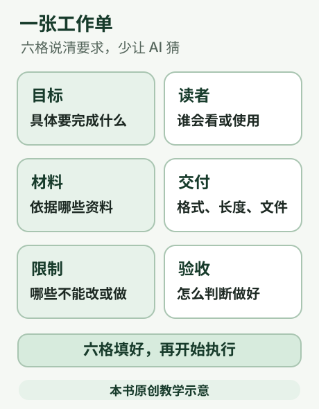

### 把口头需求写成六句话

**做什么。**“整理一份活动通知”比“处理一下”明确。

**给谁看。** 给居民、新员工、店长还是客户，决定用什么词、解释多少背景。

**依据什么。** 说明附件名称、资料日期、哪些是确定事实。存在两版资料时，指出使用哪版；不能只把文件都丢进去。

**交成什么。** 可以是 180 字通知、带公式的表格、五页演示文稿或一份 Word。只想先核文字时，直接说先交草稿。

**哪些不能改。** 例如人名、价格、原句、链接、品牌名称；缺失的字段写“待确认”。

**怎么验收。** 例如金额与原表一致、每个结论能找到来源、文件可编辑、手机阅读不横向拖动。

官方 Web 工作流同样建议说清目标、输入、要求和交付形式。本书把它展开成六个容易填写的问题，便于不同岗位使用。[官方任务流程](https://docs.qwenwork.cn/getting-started/basic-workflow)

### 通用工作单 可以直接保存

```text
我需要你完成：[一件具体事情]。
读者或使用者：[谁会看或使用]。
请依据：[附件名称、资料日期、已确认的事实]。
交付形式：[字数、页数、文件类型或表格结构]。
必须遵守：[不能改的文字/数据、不许补编的事实、操作范围]。
验收标准：[至少三条能够检查的条件]。
如缺少会影响正确结果的材料，先指出具体缺什么；不影响结果的小问题按合理方式处理并说明。
```

方括号是待替换的地方。写真实任务时，把方括号连同里面的文字一起替换；不要原样交给 AI。可以不填满所有格，但涉及日期、金额、范围的内容应尽量写清楚。

### 材料多时 先确认它看到了什么

先说：“请列出已收到的文件名，简述每份资料讲什么，指出无法读取的文件。”这一步相当于当面交接材料。文件出现在对话里，不保证其中每一页都能被正确读取。扫描件可能模糊，表格可能有多个工作表，截图可能少了最后一列。

对长资料，可以再说：“先告诉我与本任务有关的三处内容，以及所在页码或小节。”如果它给不出位置，先核实读取情况，不要马上让它写整份报告。

### 第一版不满意 怎样改得具体

不要只写“重做”“再专业点”。指出位置、问题和希望的变化：

```text
保留已经核对正确的活动名、日期、地点。
第二段太长，请拆成两段，每段最多三句话。
“免费领取礼品”不在材料中，请删除，不要用其他未经证实的福利替换。
只修改这几处，并列出修改了什么。
```

继续修改同一份成果，通常留在同一个任务里较方便，因为前面的要求和材料仍在这段交流中。开始一个无关目标时，再新建任务。若对话已经很长，可让它整理一份“当前已确认要求”，你核对后再用于后续任务；不要默认所有旧话都能被永久、完整地记住。[官方多轮交流说明](https://docs.qwenwork.cn/getting-started/basic-workflow)

### 需要中途停下的情况

发现读错文件、计算规则不对、范围越界，先使用界面的停止功能，再说明具体问题。不要一边看它按错误规则修改，一边连续追加互相冲突的要求。

涉及发送、公开发布、覆盖原稿和删除时，先确认对象与具体内容。“帮我准备客户邮件”可以理解为起草；是否发送、发给谁、附什么文件，要另外说清楚。你也可以明确授权某一项已经核对的操作；授权只覆盖说明的对象和范围。

### 十分钟练习

把“帮我写一份周报”改成完整工作单。至少补上本周三件真实进展、下周安排、给谁看、希望多长。暂时没有资料就使用模拟信息，并在结果中保留“模拟”标记。

完成后问自己：陌生同事拿到这张单，能否不猜事实就开始做？如果可以，AI 通常也更容易理解。


<a id="task-3"></a>

## 03 写出可以修改的文档

一份通知的好坏，先看读者能否知道“什么时候、到哪里、做什么”。文采、颜色和排版都排在后面。本篇用一份社区读书会通知，从原始要点做到可编辑文档；同样的方法也能用来写工作提醒、操作说明和周报。

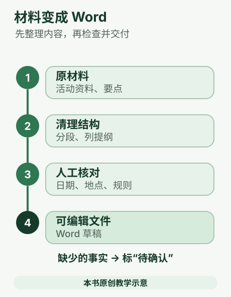

### 把散落的信息放在一起

先准备这份原创模拟材料：活动名“交换阅读经验”；2026 年 11 月 7 日星期六，上午 10 点到 11 点半；青禾社区活动室；成年人参加；自带一本愿意分享的书；不需要提前报名；没有提供任何费用信息。这里的日期、地点和规则只用于练习，不对应真实活动。

注意“不需要报名”和“免费”是两件事。没有写费用，不能把“欢迎参加”改成“全程免费”；更不能补出奖品、赞助商和联系人电话。

### 从文字稿开始

1. 在千问办公网页端登录，左侧选择「新建任务」。
2. 把材料直接粘贴进输入框。如果事实在文件里，也可以通过添加入口上传，并说明以哪份文件为准。
3. 先要求列出时间、地点、对象、准备事项和缺失信息，核对它有没有读错。
4. 再要求写通知草稿。查看内容是否齐全，以及会不会让读者产生误解。
5. 指出需要改的位置；内容确认后，再要求生成可编辑的 Word 文件。
6. 下载后用自己常用的 Word 或 WPS 打开，尝试修改一句话；确认文字和表格能改，才算拿到了可编辑成品。

官方 Web 使用流程支持新建任务、添加资料、多轮修改和检查产物；官方技能说明列出了 Word 的创建、阅读、编辑、模板填充、修订和批注能力。[Web 使用流程](https://docs.qwenwork.cn/getting-started/basic-workflow) · [Word 技能说明](https://docs.qwenwork.cn/features/skills)

### 先复制这条要求

```text
请根据我提供的模拟读书会信息，写一份给居民阅读的通知。
先列出你读到的活动名、日期与星期、起止时间、地点、对象、准备事项，以及没有给出的信息。
然后给一版150至180字的通知草稿，使用普通中文，先写时间地点，再写参加方式和准备事项。
不得添加费用、奖品、联系人、主办单位或报名链接；不要把“未提供费用”写成“免费”。
先给文字，不生成文件、不对外发送。等我核对后，再按照我的要求生成可编辑Word。
```

“等我核对”是本练习的安排。你已经提供完整标准并确认允许制作成品时，也可以一次要求生成；需要保留的文字、事实和格式仍应写清楚。

### 改稿时只指出具体问题

如果草稿里出现“名额有限，请提前扫码”，可以这样回复：

```text
删除“名额有限”和“提前扫码”，因为材料没有提供人数限制或二维码。
保留已经正确的日期、地点和起止时间。
将“请携带阅读材料”改为“请自带一本愿意分享的书”。其他事实不变。
修改后列出你改了哪三处。
```

这比“重新写得更高级”更有效，因为每一条都能检查。需要保留某句原话时，把它完整贴出并要求逐字保留；不能只说“意思别变”，却期望标点和措辞都完全一样。

### 交成 Word 时再说明版面

```text
以上文字已核对。请制作成可编辑的.docx文件。
一页内排完，正文易读，标题和段落层次清楚；不要添加未经确认的标志、二维码或联系方式。
把活动时间和地点单独列清，保留原日期、星期和起止时间。
请同时保留一份纯文字内容，方便我核对和再利用。
```

官方桌面写作工作台另有自己的路线：内容以 Markdown 文稿组织，可以编辑并导出 PDF。它的“导出 PDF”和要求生成 Word 不是同一件事；需要 Word 时明确说 `.docx`，并核实实际得到的文件。[写作工作台](https://docs.qwenwork.cn/workspaces/writing)

### 换成周报时 什么要变

把材料改成本周已完成事项、进度、遇到的问题和下周安排。给谁看很重要：给主管看，要讲影响与需要支持的事；给协作同事看，要讲交接和时间。没有完成率就不要让 AI 凑百分比，没有客户评价就不要写“获得广泛好评”。

若单位有固定模板，添加模板并说清哪些标题、页眉或表格不改。先试做一份，再核对固定名称、数字、链接和格式；不要让“润色”改变事实或承诺。

### 交付前看这六项

- 日期与星期一致，起止时间没有写反。
- 地点、对象和参加准备与原材料相同。
- 没有补出费用、奖励、人数和链接。
- 文档打开后没有文字截断、宽表溢出或乱码。
- 能直接修改正文，拿到的是所要求的文件类型。
- 对外发送前，内容负责人已确认接收对象与最终版本。

读者如果看完仍不知道怎么参加，先补清楚信息；如果只是觉得句子不够漂亮，最后再改语气。五分钟的小练习是：故意删掉一项地点信息，看 AI 会标“待补充”，还是编造一个地址。


<a id="task-4"></a>

## 04 让一张表把情况说清楚

你可以在这里学会：给千问办公一份表格，让它先检查，再按你说清楚的规则求和、比较和做图。AI 表格分析像请一位同事帮你对账和画图，但你要先告诉他哪些行算数、每个数字代表什么。检查口径这一步，不能因为图做得漂亮就跳过。

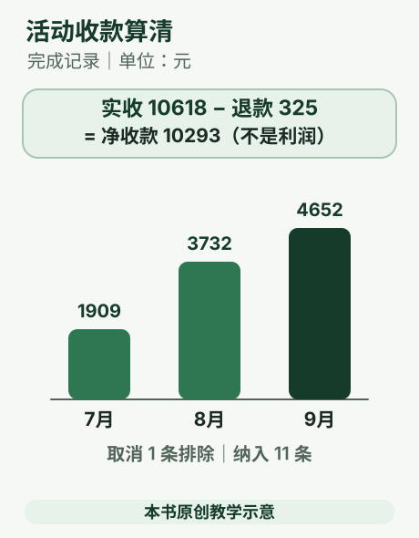

### 先用生活例子理解

想知道社区活动7—9月哪月净收款高，可以把报名记录整理成表格，再按月份汇总。就像把每张报名凭据放进对应月份的信封，退款要按事先约好的规则放回原报名记录月份。若把“取消”报名记录也算进去，或者把退款忘了扣，最后结果就会变样。

本章使用原创模拟文件「活动报名练习.csv」，不是现实经营记录。CSV 是用纯文字保存的简单表格格式，可以用 Excel 或 WPS 打开。练习口径：仅统计状态为“完成”的报名记录；净收款 = 实收 - 退款；退款按原报名记录日期所在月份归集；净收款不是利润，也不是现实财务记账规则。金额单位为元。

### 开始前准备什么

只需要本书附带的「活动报名练习.csv」和本章口径说明。网页开卷处可以下载文件；编辑版配套包的 practice 文件夹中也有。表头是：报名号、日期、报名渠道、活动、人数、每人费用、减免、实收、退款、状态。每一行是一条报名记录。状态“完成”表示本题纳入，状态“取消”表示排除。正式工作中，你需要向数据提供者确认每列的意思、金额单位、是否重复、空白代表什么、退款归属规则。不要把这个练习约定误当成通用财务标准。

### 编号操作步骤

1. 登录千问办公网页端，左栏选择「新建任务」，从输入框添加入口上传「活动报名练习.csv」。[官方使用链路](https://docs.qwenwork.cn/getting-started/basic-workflow)说明可在任务中加入本地参考文件。
2. 先告诉 AI 口径，让它检查行数、取消行、空白值、重复报名号、日期和金额字段，再让它复述统计范围。发现问题时先暂停，别马上做图。
3. 让它计算完成报名记录实收、退款、净收款，按月份和报名渠道汇总，并列出公式和明细。先看数字是否正确，再让它做图或生成 Excel。
4. 追问任一数字如何得出。例如要求列出每月纳入哪些报名记录、退款如何扣除。拿计算器或表格复核总和。
5. 确认口径和数字后，再要求生成带单位、标题、数据标签的图表或可编辑 Excel 分析结果。

### 可复制提示词

```text
请分析附件“活动报名练习.csv”。这是原创模拟数据，不是真实经营记录。先检查表格，报告总行数、各状态行数、空白、重复报名号和日期格式问题；有问题先列出，不要自行猜测修复。
本练习口径：只纳入状态为“完成”的报名记录；净收款=实收-退款；退款按原报名记录日期所在月份归集；金额单位为元；“净收款”不是利润，也不等于会计确认收入。
检查完成后，请计算纳入报名记录数、实收合计、退款合计、净收款合计、7至9月各月净收款和环比、各报名渠道净收款。列出公式和中间结果，不推测变化原因。最后给我一份简短的中文结论和一张注明单位的月度图表。
```

### 确定结果（答案不隐藏）

总共 12 行：完成 11 行，取消 1 行，纳入计算的报名记录数是 11。实收合计 10618，退款合计 325，净收款为 10618 - 325 = 10293。按报名记录日期所在月份归集，7 月净收款 1909，8 月 3732，9 月 4652。环比公式是“（本月 - 上月）÷ 上月 × 100%”：8 月比 7 月增加 95.50%；9 月比 8 月增加 24.65%。按报名渠道净收款：活动室 4821，社区群 2972，图书馆 2500。三类报名渠道合计 10293，与总净收款一致。

这些结果只按本章模拟表和口径计算。表格没有参加动机、天气、成本或宣传渠道信息，所以不能据此说“某个活动导致收入上涨”，也不能把净收款当成利润。

### 验收与出错怎么办

核对四处：纳入数 11；实收 10618；退款 325；净收款 10293。再看月份是否是 1909、3732、4652，报名渠道合计是否也等于 10293。环比比较相邻月份，不是拿本月去除以全部月份。图表标题应写清“净收款（元）”，避免只写“收入”。

- **AI 算出 12 笔：** 提醒它排除“取消”状态，再让它列纳入的报名号。
- **退款处理不一致：** 重复本章口径，并要求按报名号展示退款扣在哪个月。
- **金额不对：** 检查 CSV 是否完整、逗号分隔是否被错误识别为列；可先用 Excel/WPS 打开确认列头和数据。
- **环比说成涨跌原因：** 要求只陈述计算结果；原因要另找活动安排、天气等证据。
- **图好看但数字错：** 先回到计算明细修正，再重新画图；不要凭颜色或柱子高矮验算。

### 5 分钟练习（模拟）

在 Excel 或 WPS 打开模拟 CSV，数一数状态为“取消”的行，确认是 Q012。手算 8 月净收款：实收 3850，退款 118，结果 3732。再用提示词让 AI 复核。练习用数据纯属模拟，任何人都可重复计算，不代表真实活动结果。

### 这份表下次还能怎样用

“先查数据，再定口径，再算数，最后做图”是可靠的顺序。官方说明支持分析本地文件、在线文件、制作可视化报告和处理 Excel；分析结果仍要用原表抽查。

官方资料：[分析数据](https://learn.qwenwork.cn/docs/tasks/data-analysis.html) · [技能：xlsx](https://docs.qwenwork.cn/features/skills) · [生成内容：Excel 示例](https://learn.qwenwork.cn/docs/tasks/content-generation.html)


<a id="task-5"></a>

## 05 把流程讲给别人听

演示文稿就是讲解时给大家看的几页“路标”。不需要把整篇文档搬上去；每页帮助听众回答一个问题，就已经很有用。本篇不用经营汇报做练习，而是把参加读书会的步骤，讲给第一次参加的居民听。

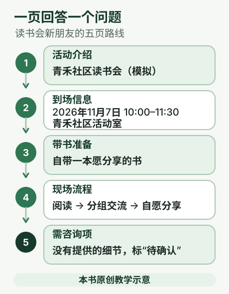

### 先确定听众看完能做什么

这份原创模拟材料只有五条：读书会在青禾社区活动室举行；2026 年 11 月 7 日 10 点开始，11 点半结束；参加者自带一本愿意分享的书；先自由阅读 20 分钟，再分组交流，最后自愿分享；不需要提前报名。没有提供活动室平面图、收费和座位上限。

希望听众看完后能说出：何时到、到哪、带什么、现场怎么参与。因此用五页足够：活动介绍、到场信息、带书准备、现场流程、仍需咨询的问题。没有地址细节就不要生成假的路线地图；没有确定收费就不要写“免费”。

### 千问办公里怎么开始

1. 登录桌面客户端，进入新任务。在输入框附近找到工作台选择位置，默认通常是「通用」，切换到「幻灯片」。如果当前版本没有这个入口，先按末尾的替代路线做。
2. 添加或粘贴活动材料，说明读者、讲解时长、页数、风格和不能编造的内容。
3. 先等大纲。大纲就是每页标题和要讲的要点，还不是最终页面。
4. 在「大纲」位置检查顺序。遗漏时间地点就先修改；不合适可以反馈后重排，满意后再接受大纲。
5. 生成页面后逐页检查，针对某页指出修改，而不是笼统要求整份重做。
6. 放映检查后，从导出入口选择实际需要的 PPTX、PDF 或 HTML，再打开导出文件复查。

这条路线依据官方[幻灯片工作台说明](https://docs.qwenwork.cn/workspaces/slides)。官方说明默认以 16∶9 的 HTML 画布制作幻灯片，并提供 PPTX、PDF、HTML 导出；预览顺利不等于导出文件在你的演示设备上也毫无问题。

### 可直接复制的制作要求

```text
请把我提供的模拟读书会资料整理成5页演示文稿，给第一次参加的成年人看，讲解约3分钟。
目的：听众看完能知道何时到、到哪、带什么、现场怎样参与。
先只列大纲，每页写“这页回答的问题”和最多3个要点，等我检查后再制作页面。
只使用提供的信息，不编造路线地图、人数限制、收费、礼品和联系人。
文字用普通中文，少用长句；每页一个重点。时间、地点和准备事项醒目。
图示必须标明是示意，不得画成真实场地平面图。
```

大纲通过后，可以追加：“按确认大纲制作，绿色与白色为主，正文不要挤，每页保留足够留白。”如果单位有模板，先提供模板并说明需要保留的元素，不要只说“像我们公司的风格”。

### 一页内容的具体示范

**页标题：到场前带什么。** 正文只保留“带一本愿意分享的书”“不用提前报名”“活动 10 点开始”。用三个简洁图标帮助扫读即可，不必把整段活动介绍重复一遍。

**页标题：现场分三段。** 画阅读、交流、分享三个连续步骤。材料只规定阅读 20 分钟，没有规定后两段各多少分钟，所以不要为了填满时间轴擅自写“交流 40 分钟、分享 30 分钟”。总时长能算出来，也不代表每个环节的分配已经确定。

### 什么时候加页 什么时候删字

一页回答两个不相干的问题，就考虑拆页；一个完整句子写了五六行，就考虑删掉不影响理解的修饰。图表、流程图和图片应帮听众理解内容，不是为了把页面填满。

可以这样改：“第 4 页只保留三个流程名称；说明移到讲解备注。不要改变流程顺序，也不要补充环节时长。”一句“更简洁”不能保证 AI 删掉的恰好是次要信息。

### 需要在 PowerPoint 里继续改

选择 PPTX 交付，并用自己实际使用的 PowerPoint 或 WPS 打开。尝试修改标题和移动一个元素，看可编辑程度是否满足需要。不同软件、字体与页面元素可能影响显示；如果只要稳定阅读或打印，可再准备 PDF。不要把 HTML 文件改个后缀就当成 PPTX。

若没有专用工作台入口，官方常见任务页也展示了在通用任务中制作演示文稿的用法。你可以直接要求“生成可编辑 PPTX”，核对实际结果；也可以先得到核实过的大纲，再到熟悉的演示软件排版。[官方内容生成示例](https://learn.qwenwork.cn/docs/tasks/content-generation.html)

### 演示前一分钟的检查

从第一页放到最后一页，确认字看得清、图没挡住文字、日期和地点一致、没有虚构地图或时间安排。用将要演示的设备打开一次；需要离线播放，就在断网前先验证文件可用。

最后请另一个人复述参加流程。如果他能答出何时到、到哪、带什么、怎么参加，这份演示就达到了本次目标。练习时也可故意去掉一页，观察哪项信息因此变得不清楚。


### 看一眼官方工作台示例

看图时先找顶部的“幻灯片、大纲、文件”和右上角的“导出”。左侧展示生成过程中的技术信息，初次使用可以先集中检查右侧页面和大纲。

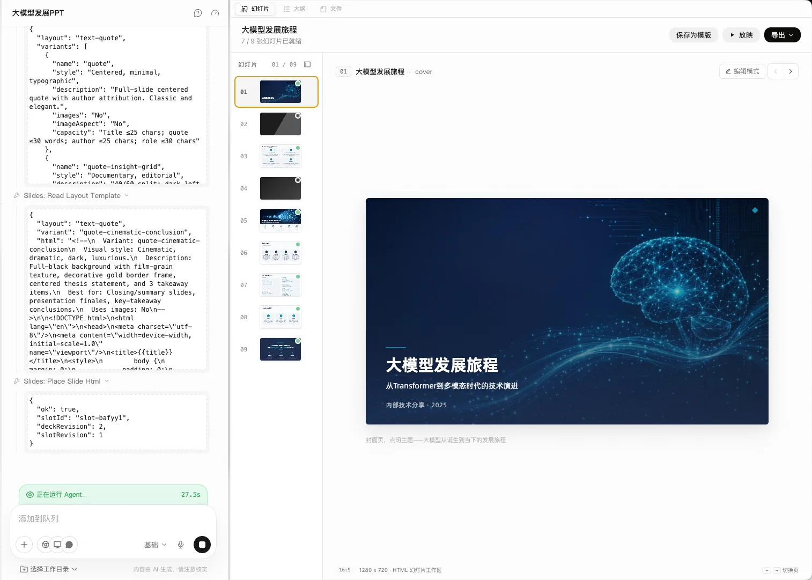

图源：[千问办公官方幻灯片工作台](https://docs.qwenwork.cn/workspaces/slides)，查阅于 2026 年 10 月 23 日。这是官方示例，帮助识别大纲与页面所在区域；不是本书练习的实际生成结果。


<a id="task-6"></a>

## 06 查资料时把证据留下

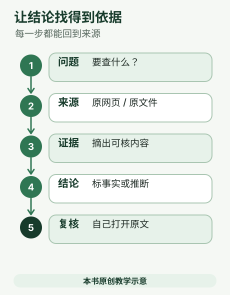

下周读书会要换场地，你负责找三个适合 12 人讨论的社区空间。你手头有活动需求表、场地方公开介绍和几张报价单。此时最需要的不是一篇“场地推荐”，而是能说明容量、交通、费用和开放时间来自哪里的一份比较表。先把问题拆成外部资料调研和内部文件问答两条，再把证据逐条核对。

### 先把问题变成可核对的清单

先列筛选条件：至少容纳 12 人、公共交通方便、可使用 2 小时、价格在预算内、允许讨论交流。把每项改成能查证的问题，例如“页面是否写明可容纳 12 人？”“报价是否含场地费和清洁费？”这样 AI 才能把未知项留空，而不是用一段顺口的推荐替你做决定。千问办公 Web 端官方说明支持信息研究和文件处理；个人网盘可保存资料并在对话中选取复用。[网页端核心功能](https://docs.qwenwork.cn/web)；[个人网盘](https://docs.qwenwork.cn/web/personal-drive)

### 准备材料

这是本书的原创模拟情境，不是产品实测。准备一页活动需求表、三家场地的公开介绍链接、场地方回复的报价单，以及上次活动复盘。公开页面用来核对地址、开放时间和设施；报价单回答真实价格；复盘可提醒你留意噪音、交通等体验。不要把参与者手机号等无关个人信息上传。

千问办公的个人网盘是云端文件空间，可放用户资料与生成文件，也可在对话中附加读取；桌面端另有本地文件处理路径，具体能力随端不同。[个人网盘指南](https://docs.qwenwork.cn/web/personal-drive)；[常见问题：端能力差异](https://help.aliyun.com/zh/qwenwork/product-faq)

### 操作步骤

1. **先问清问题。** 把大题改成能验证的小题，例如“是否能容纳 12 人”“最近的公交/地铁站是什么”“周六下午是否开放”“报价是否含清洁费”。限定场地范围、活动日期和可接受价格。
2. **整理材料。** 文件用能看懂的名字，如“需求清单_讨论版”；保留原文件，不把 AI 改写稿覆盖原件。网盘可复用的文件先上传一次，后续在新任务里选择；临时材料也可直接作为附件。
3. **先让 AI 建证据表。** 一行一个场地条件，列“结论、材料依据、来源链接或文件定位、页面日期、是否仍需确认”。优先使用场地方正式页面或回复；找不到就标“未找到”，不要用无来源断言补齐空白。
4. **再问你的文件。** 对报价单和复盘逐题提问，要求标注文件名及页码、段落或表格行。若来源文件没有页码，要求引用标题和原句关键词，方便你搜索定位。不要把文件里未出现的条件当作已知。
5. **交叉核对。** 打开链接，确认它确实支持旁边的结论；检查发布日期、适用对象和计价口径。打开原文件定位引用。对关键数字至少独立核对一次。
6. **再写简报。** 证据表通过后，要求将内容整理成一页摘要，保留不确定项与待办问题。先看证据，再读流畅的结论，避免被漂亮措辞带着走。

### 可直接复制的提示词

```text
你是我的资料助理。请帮我为一次 12 人读书会比较社区活动场地，完成初步调研，不要替我直接选定场地。

范围：地点=[城市/街区]；活动日期与时段=[日期/时间]；预算上限=[金额]；候选场地=[场地名称或公开链接]。
筛选条件：至少能容纳 12 人、有可讨论的座位安排、交通可达、开放时间覆盖活动时段、价格不超过预算。
允许来源：优先场地方自己的官网/官方账号/书面报价，以及我提供的文件；其他来源须说明用途。
材料：本次附件或个人网盘中的活动需求表、报价单、上次活动复盘。先列出实际读取到的文件名；读不到要明确说。

按以下顺序工作：
1. 按候选场地逐项检查筛选条件，输出比较表；不要仅凭“看起来合适”推荐。
2. 每项给出：暂定结论、依据摘要、可点击来源链接或文件定位、来源日期（未标日期写“未标注”）、适用范围、可信度或限制。
3. 严格区分“来源明确写出的事实”“基于材料的推断”“材料/来源没有回答的问题”。禁止补造链接、数字、发布日期或引文；证据不足就写“未知/未找到”。
4. 文件问答请标明文件名与页码/章节/表格行；不能定位时给出可搜索的标题或关键词，并说明定位限制。
5. 先不要生成最终宣传结论。最后列出需要我亲自打开原文确认的 3 项，以及可能影响结论的缺失材料。
```

### 预期结果与核对项

你应该得到一张可逐行查证的场地比较表，而不是只得到一段推荐。重点核对：地址与时段是否来自场地方；容量是否明确写出；报价里的押金、清洁费和时长限制有没有漏；文件问答是否指出原文件位置；AI 是否把推测写成设施事实。网页没写价格不代表免费，正确记录是“公开来源未标价，需联系场地方确认”。

可以把结论写成“已证实 / 待确认 / 不符合”，避免把资料空缺误看成场地缺陷。例如官方页面没写无障碍入口，就应标“未找到说明”，而不是断言没有；如果报价单和网页价格不同，保留两条原始记录并注明日期，交由场地方确认哪条适用于活动日。

千问办公官方 Web 工作链路是“登录、创建任务、补充资料、多轮沟通、检查结果、保存/复用或发布”。照这个顺序走，先用一份低风险材料试一题，再扩大范围。[Web 端使用链路](https://docs.qwenwork.cn/getting-started/basic-workflow)

### 出错怎么办

文件没读全：检查格式、大小和上传状态，把问题缩小到一个文件或一张表，并让它先复述读取到的范围。引用对不上：不要让 AI 再“确认正确”，而是回原件搜索标题/关键词，找不到就删除该结论或补材料。来源质量差：收紧来源要求，指定官网入口和时间段，拒绝以搜索摘要代替原文。回答过长：一次只查 3–6 个小问题。结论涉及采购、合规或安全时，把 AI 输出当作草稿，由对应负责人审定。

### 练习

拿一张虚构的场地报价单和一段公开场地介绍，问三个具体问题，并要求给出文件定位和来源；把“事实、推断、未知”用三种标记区分，随机抽查两条。完成标准不是文风像推荐文，而是读书会组织者拿着链接和文件能复现你的比较。


<a id="task-7"></a>

## 07 整理经得起追问的记录

聊天记录、顾客反馈、访谈笔记都有一个共同点：说话是随时发生的，记录却需要有顺序。整理时，最容易出的问题不是语句不通，而是把“有人提出”写成“大家决定”，把“希望”写成“承诺”。

本篇用一段原创模拟访谈来练习。这样不需要录音设备、不需要接入企业系统，也能学会把原话整理成可以核对的结果。

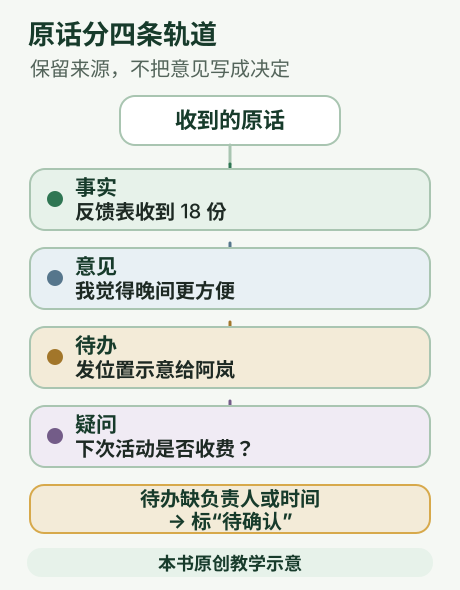

### 先分清三种句子

**事实** 是材料已经明确说出的情况。例如“反馈表收到了 18 份”，仍应核对原表有没有 18 份。

**意见** 是某个人的评价和建议。例如“我觉得晚间场更方便”，只代表这个人的意见，不能写成“居民普遍喜欢晚间场”。

**待办** 是已经交代要做的事。需要知道做什么、由谁做、什么时候完成；没有说明的字段写“待确认”。

还有一种需要单独留下的内容：疑问。整理不是把每一格都填满，缺失信息也属于重要结果。

### 给你一段完整材料

```text
模拟访谈记录，2026年10月21日。
记录人问：上次社区读书会怎么样？
阿岚：我参加了上午场，找活动室花了十分钟，楼下没有指引。
小周：我觉得晚上可能更方便，不过我没有问过其他人。
组织者：收到的纸质反馈表一共18份，内容还没有统计。
记录人：下次能不能做个路牌？
组织者：可以先画一版。我周四前把活动室位置示意发给阿岚。
阿岚：我拿到位置示意后可以做一张指引图，但交稿日期还没定。
小周：如果以后收费，我可能不参加。现在有没有收费计划？
组织者：目前没有决定，先不要对外说。
```

在网页端新建任务，把材料直接粘贴，或者保存为文字文件后添加。用附件整理内容是官方 Web 任务流程支持的用法；如果要读取钉钉 AI 听记、创建钉钉待办，还需要相应可用能力和授权，不能把粘贴文字与自动接入混为一谈。[Web 端流程](https://docs.qwenwork.cn/getting-started/basic-workflow) · [钉钉集成示例](https://learn.qwenwork.cn/docs/tasks/dingtalk-integration.html)

### 可以复制的整理要求

```text
请只根据下面这段模拟访谈，整理一份内部记录，不对外发布。
分成四部分：已知事实、个人意见、待办事项、仍需确认的问题。
每条写明对应说话人，并附一小段原话作为依据。
不要把意见写成统计结论，不要把讨论写成已经作出的决定。
待办列出事项、负责人、前置条件、截止日期；原文没有写的内容标为“待确认”。
“周四”请根据访谈日期换成明确日期，说明换算依据；有歧义就指出。
最后列出不能从这段材料得出的结论。
```

### 应该整理出什么

已知情况包括：阿岚自述参加上午场且找路花了十分钟；组织者称收到 18 份纸质表，尚未统计。这些是访谈中的陈述，不能升级成已完成外部核验的事实。

小周认为晚间可能方便，但明确没有调查其他人。收费问题没有决定，记录不应写成“下次收费”或“永久免费”。

待办至少有两项：组织者在周四前给阿岚发位置示意；阿岚收到示意后制作指引图，交稿日期待确认。访谈日期 2026 年 10 月 21 日是星期三；若理解为紧接着的周四，日期是 10 月 22 日。“周四前”是否包含周四当天仍可能有歧义，正式安排应询问组织者，而不是悄悄改成当天 18 点。

这份记录不能证明全体居民的偏好、下次参加人数、活动效果提升幅度或收费安排。18 份表只是已收到的数量，尚不能支持满意率。

### 如果材料是录音或截图

先检查人名、数字和专有名词是否转写正确。发言人不明就用“说话人待确认”；不要根据语气猜身份。录音中听不清的片段可以注明时间位置，交给熟悉现场的人回听。

截图需要完整上下文。只截“可以”两个字，无法知道答应了什么。敏感聊天不要整段随意上传；使用获准的材料，并遮去与任务无关的姓名、联系方式等信息。

### 记录能否交付 看这五项

1. 每条事实都能回到原话，且保留是谁说的。
2. 个人评价没有被扩大成群体结论。
3. 待办保留负责人、时间和依赖条件；未知明确留空或标待确认。
4. 没把“未决定”改成“已批准”，没编补预算或承诺。
5. 对外版本删去了不宜公开的信息，并经过内容负责人审核。

练习时故意把“尚未统计”删掉，再比较两版记录。你会看到，少掉四个字，就可能把未完成工作误写成已有结论。整理记录的价值，正是把这些差别保留下来。


<a id="task-8"></a>

## 08 做出可以预览的宣传内容

这一章把三件事连起来：用简单话说明想要的图片或短片、检查生成结果，再把介绍内容做成能打开的网页。图片是用来看重点的画面，视频是在时间里连续播放的画面，网页则像一张可以通过链接给别人看的在线说明页。

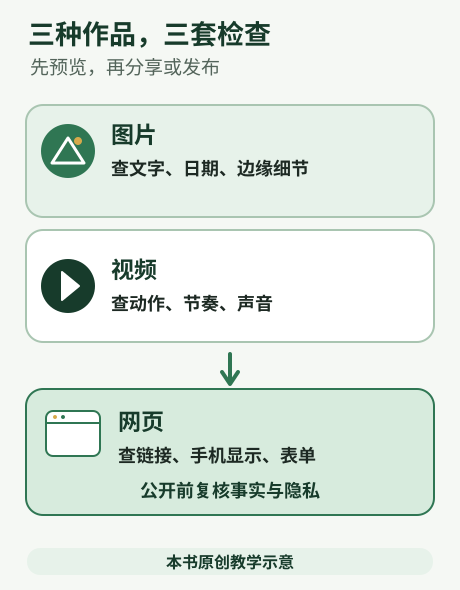

### 先用生活例子理解

你要为社区跳蚤市场做宣传，可以先准备一张活动海报，再做一段介绍短片，最后做活动网页告诉大家日期、地点和报名办法。海报、视频和网页的信息必须一致：日期错一天，视觉再漂亮也会让人白跑一趟。先把事实写对，再制作素材。

官方学习站把生成图片、视频和音频列为常见任务；另有「我的网页」功能，能通过对话描述需求，检查后发布到公网并得到链接。本章只使用这些官方说明确认的能力，不声称练习已经在某个账号上成功生成或发布。

### 开始前准备什么

图片最少准备主体和用途，比如“社区旧物交换活动的海报”。视频还要说明要表现的动作和场景，比如“摊主摆放书籍，镜头扫过活动时间牌”。网页最少准备标题、时间、地点、活动说明和联系方式。报名表若要保存访客填写内容，还要想好收集哪些字段及其用途；个人资料的收集范围应尽量少。

### 编号操作步骤

1. 登录千问办公网页端或官方快速上手页面列出的其他入口，开始新任务。具体账号能否看到图片/视频生成选项，以当前页面为准。
2. 先生成图片：说明用途、主体、画面内容、色彩感觉、竖版/横版等需求。若当前界面支持添加参考图，可以附上自有或有权使用的图片。
3. 预览并检查图里的字、日期、人物手指、商品标志和边缘细节。不对就指出一两项具体改动，不要只说“更好看”。
4. 视频任务说明主体、动作、场景、节奏和大致时长，等待生成并预览。时长、分辨率和可下载格式以当前界面实际提供为准；官方常见任务页没有统一公布这些上限。
5. 做网页时，在对话里明确列出用途、读者、栏目和已确认的事实。先检查内容和页面预览，再按产品实际提示确认发布。
6. 发布后打开返回的链接，检查手机上是否看得清、图片能否显示、日期和地点是否正确。修改时通过对话生成新版本，满意后分享链接。

### 可复制提示词

```text
请为“社区旧物交换日”生成一张简洁的竖版活动海报。
已确认信息：时间为10月30日（周五）下午2点；地点为青禾社区活动室；活动方式是居民自愿交换书籍和小家电。
画面希望有整齐摆放的旧书和小台灯，温暖、明亮、友好。海报文字只放活动名称、时间、地点，不要添加收费、奖品或报名人数等没有提供的信息。生成后请检查文字和日期是否准确。
```

```text
请制作一个“青禾社区旧物交换日”介绍网页，面向社区居民。展示活动时间、地点、交换规则和联系人。只能使用我提供的已确认信息；没有提供的事项写“请联系社区确认”，不要自行补充。先给我检查网页内容和效果，再按页面提示发布。发布后告诉我公开链接，并说明如何查看历史版本。
```

这是模拟活动示例，日期、地点和活动设定都是虚构的教学内容，发布前不要照搬到真实活动。

### 预期结果与边界

图片任务应返回供预览的图像；视频任务应返回可预览的动态画面；我的网页路线应返回可访问链接。网页官方说明支持静态展示页和带数据库的动态页面。学习站写明默认分配 `*.qwenwork.host` 网址域名；不同套餐提供的网页数量和访问量不同，因此本书不承诺具体免费额度。页面指出自定义域名标示为即将上线，不应把它当作当前可用入口。

需要保存报名信息或留言的网页，会涉及额外的数据处理；先用最少字段和虚构信息试填。复杂业务系统需要技术人员评估，不要把一个可预览的网页当成已经通过业务验收的完整系统。网页发布会形成新版本，可以查看和回滚；删除网页则会永久清理网页及关联数据库，不能恢复。发布公开页面前，先去掉电话、住址等不必要的个人信息。

### 验收与出错怎么办

海报核对活动名、日期、地点是否正确，文字是否被遮挡；视频检查主要动作和画面是否符合说明；网页用手机打开链接，逐项核对事实、按钮、图片和表单。若网页包含报名，先用虚构信息试填，检查提交后提示是否合理。涉及真实个人信息或公开发布时，内容负责人要最后复核。

- **图中文字不对：** 减少海报内文字，明确指出要修正的字；也可以让画面不带字，之后用常见排版工具加字。
- **视频动作不符合：** 拆成更具体的一两个动作，先描述主要主体和场景，再迭代。
- **网页资料不完整：** 先补齐时间、地点、联系人，不要让 AI 编造。
- **链接打不开：** 查看网页管理入口中的状态，等待部署完成后重试；官方文档提到网页可能有短暂部署等待，动态网页还可能有首次唤起时的等待。
- **担心内容被所有人看到：** 在分享前检查访问设置；若页面提供访问密码，可按官方页面指引设置。不要用删除代替暂时停止分享，删除会清空数据库。

### 5 分钟练习（模拟）

用上面的虚构社区活动试写两条提示词：一条生成海报，一条生成介绍网页。把它们的时间、地点逐字比较，看看是否保持一致。只练习生成和预览，不需要把虚构活动发布到公网。

### 做完后保留什么

制作可分享内容的顺序是“先写准事实—描述画面—预览修改—检查链接”。生成图片、视频和音频是官方列出的任务场景；网页发布、默认域名、版本和动态页面边界以[我的网页](https://learn.qwenwork.cn/docs/features/my-webpage.html)说明为准。

官方资料：[生成多媒体](https://learn.qwenwork.cn/docs/tasks/multimedia.html) · [快速上手](https://learn.qwenwork.cn/docs/getting-started/quickstart.html) · [我的网页](https://learn.qwenwork.cn/docs/features/my-webpage.html)


<a id="task-9"></a>

## 09 同一件事下次少说一点

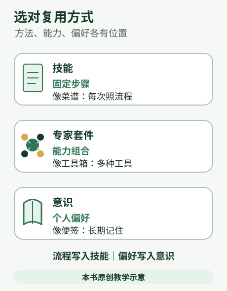

你每周都要替社群发布活动公告：有人报名时忘了写地址，有人把时间写成上周，还有人把“建议携带”写成“必须携带”。你想让 AI 先按固定格式整理，再由你审核发布。要解决它，得把反复使用的规则存下来；但方法、岗位能力包和个人偏好要放在不同位置。

### 先区分要保存的东西

先区分三种需求：公告每次都用的顺序、禁用词和核对步骤属于技能；若社群运营岗位需要一组统一流程、数据连接和多个技能，才查看专家套件；“我习惯先看短版、用亲切语气”这样的个人偏好，才适合记录在意识。官方把 Skill 定义为预设的专业工作流；专家套件是一组岗位或场景能力，可能包含多个 Skill 和连接器。[技能](https://docs.qwenwork.cn/features/skills)；[扩展：专家套件、技能与连接器](https://docs.qwenwork.cn/features/extensions)

### 三种东西，三个用途

**技能** 回答“遇到这类任务时，按什么方法做”。例如公告先确认活动名称、日期、时段、地址、对象、报名方式，再检查必需字段。技能适合稳定、反复执行的流程。官方文档说明 Skill 可用自然语言写清名称、触发条件与步骤，并可通过技能广场、对话搜索或上传文件获取/安装。[技能指南](https://docs.qwenwork.cn/features/skills)

**专家套件** 回答“某个岗位需要哪些能力组合”。它可以把行业知识、工作流、判断标准，以及多个技能和连接器组合起来，便于团队按一套方案配置。单人整理社群公告通常不需要先装套件；只有社群运营确实需要组合多项专业能力时，才去扩展里查看可用内容。实际有无、是否开放，取决于当时广场和账号权限。[专家套件](https://docs.qwenwork.cn/desktop/expert-kits)

**意识** 回答“AI 如何长期记住我怎样协作”。官方桌面文档将它描述为个性化与跨会话记忆系统，包含协作风格、工作手册、用户画像、长期记忆和短期记忆，并有自动记忆等设置。适合记录稳定偏好，例如中文表达、先给摘要、未经确认不改原文件。它不是自动生成活动公告的流程，也不能代替每次任务所需的活动资料。清空记忆或重置工作手册会删除/覆盖内容，修改前要看清操作提示。[意识](https://docs.qwenwork.cn/desktop/memory)

### 准备材料

这是原创模拟情境，不是产品实测。准备一份虚构活动资料：活动名、日期、开始和结束时间、地址、适合人群、报名入口、名额、费用、携带物品和联系人。再写一段你希望的公告风格、社群常用格式，以及两份旧公告（可虚构）。把个人手机号、真实群二维码和未公开报名名单删去。先按自己的方式写一版满意公告，圈出每次重复的顺序与检查规则。

### 做出第一个“活动公告方法”

1. **先手动跑通。** 在普通任务里附上练习材料，让 AI 产出公告草稿。来回修改，直到顺序和语气符合要求。先做出稳定流程，才知道应该固化什么。
2. **列出不变规则。** 写清楚必需字段、时间格式、价格/报名信息口径、不能推测的内容、输出板块和篇幅。例如“日期只采用活动资料；地址缺失时标为待补充；不得创造报名链接”。
3. **让 AI 起草 Skill 文件。** 要求只生成草稿，不替你直接保存或覆盖本机文件。先逐条审核规则，移除过时、含糊或不适用的要求。
4. **按当前产品入口安装。** 官方技能指南描述了从扩展/技能广场安装、对话里搜索技能或上传本地 `SKILL.md` 的路径。如果它目前只返回文字，可继续要求“请按当前千问办公技能导入要求，把已确认说明整理成可下载的 SKILL.md 文件，并列出缺少的配置”。下载后，在技能的上传入口选择该文件，检查名称、说明和授权提示再导入；导入不成功时按页面错误修正，不能把改个文件后缀当成制作成功。实际页面可能随版本变化；不熟悉文件操作的读者，也可以先把已核对的提示词存在普通文档里，每次复制使用。
5. **用第二份活动资料复测。** 换一份日期、地点和对象都不同的虚构资料调用技能，检查它是否遵守范围和空值规则。若结果不稳，先修订技能说明，而不是不停追加临时要求。
6. **再考虑记忆。** 若偏好适用于各种任务，可通过桌面端意识功能记录；不要把本周临时指标、机密内容或必须每周更新的数据放进长期偏好。

### 可直接复制的提示词

```text
请根据附件中的活动资料起草一则中文社群活动公告。先不要发布或保存覆盖原文件。

只使用资料明确提供的信息；先列出已读取到的活动字段。
按“活动名称 / 时间 / 地点 / 适合谁 / 活动安排 / 报名方式 / 名额与费用 / 温馨提示”整理；资料没有的字段写“待补充”。
日期、地址、费用、名额和报名链接必须逐字核对资料，不要推测，不要创造链接或联系人。
语气轻松清楚，不夸大活动效果；区分“建议携带”和“必须携带”。
先给我一版可审阅公告，再列出缺项、冲突和需要组织者确认的问题。

当我确认这套步骤后，请另起一个“社群活动公告 Skill 草稿”，内容需包含：
技能名称与适用场景、何时触发、所需材料及字段、逐步处理规则、输出格式、禁止推断项、核对清单、缺资料时的处理方式。
用自然语言写，保持简短清晰；把不确定的业务口径标为待我填写。只返回草稿，不安装、不覆盖任何文件。
```

### 预期结果与核对项

你会先得到一则待审公告和缺项清单，再得到一份 Skill 草稿。检查日期和星期是否相符、地址与报名链接是否来自材料、费用和名额有没有被补造、温馨提示有没有改变原意。Skill 的触发条件要明确，输出格式要让社群成员一眼找到时间和报名方式；缺材料时必须询问组织者或标为待补充。换一份活动资料复测，确认方法并非只适用于一场活动。

### 出错怎么办

生成结构不稳定：把公告板块、顺序和字段写进 Skill，不只写“按社群习惯”。日期或地址错：要求模型先复述读取到的字段，逐项对照原资料。个人语气与社群公版不一致：个人偏好放在意识，社群统一流程放在经认可的技能/方案中，并先确认团队是否允许共享。误操作重置：官方文档提醒重置协作风格、工作手册、清空记忆会清理配置或记录；先备份，再按页面提示操作。

### 练习

编两场虚构活动，分别写公告提示词、Skill 草稿和两条适合写入个人协作偏好的内容。把 Skill 草稿给社群伙伴，用第二场资料生成公告，检查字段顺序和缺项处理是否一致。完成标准是公告能复用、活动事实仍可追溯，并且个人偏好、工作方法和岗位套件没有混为一谈。


<a id="task-10"></a>

## 10 从外部工具取资料

千问办公刚开始像一个会写东西、会整理材料的助手。接上浏览器、日历、网盘或团队应用后，它还能读取资料、替你填写内容，甚至安排定时任务。能力变强，关键问题也跟着变简单：这次任务需要它看什么、改什么、发给谁？把这三件事说清楚，再给刚好够用的权限，既容易上手，也少出意外。

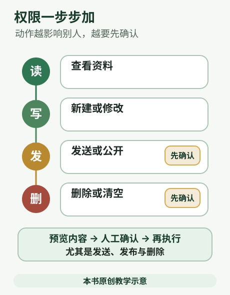

### 先认识连接器：给助手一扇有范围的门

连接器就是千问办公和其他应用之间的通道。官方帮助列出的内置连接器包括浏览器、部分 Mac 应用和 Microsoft 365；应用市场还能连接钉钉、飞书、Notion 等服务。没有连接器时，千问办公仍能处理对话和本地文件；连接后，才可能读取或操作相应服务。连接器默认关闭，只有完成设置和授权后才能使用。具体能做什么，要看连接器页面显示的能力和授权范围，不能把“已连接”理解成“什么都能做”。

官方说明：[连接器](https://help.aliyun.com/zh/qwenwork/desktop-connectors)、[常见问题：平台和功能差异](https://help.aliyun.com/zh/qwenwork/product-faq)。这些页面会随产品更新，操作前以你当前界面为准。

第一次使用，可以按这个顺序：打开「扩展」里的「连接器」，找到确实需要的服务，阅读权限说明，再决定是否开启。比如只是想整理本地文件，就没有必要顺手连接邮箱；只是让它查日程，也不需要给它无关的网盘资料。用完后可以回连接器列表检查开关和授权，暂时不用就关闭。

### 用“读、写、发、删”判断风险

读，是查看资料，例如读一份会议记录；写，是创建或修改资料，例如在表格里补一列；发，是让信息离开当前工作区，例如发邮件、群消息或发布网页；删，是让文件、记录或设置消失。这四种动作都要按资料敏感度、影响范围和能否撤回评估；读取大范围敏感资料也可能有很高风险。每次委托前，先说清四件事：允许读取哪些来源、可以写到哪里、是否允许对外发送、哪些东西绝对不能删除。

例如，初次整理邮件可以这样写：“只读取今天主题含‘会议’的邮件，把日期、参与人和待办整理成一份本地草稿；不要回复、转发、删除或改动原邮件。完成后列出你处理过的邮件主题。”这句话给了范围，也让结果容易核对。等你确认流程稳定后，再考虑是否增加操作权限。

千问办公可以通过浏览器操作网页，也能在获得系统授权后使用电脑操控能力；这不表示它能绕过登录、验证码或所有安全限制。官方文档指出，复杂验证码、短信验证和扫码登录需要用户手动完成；电脑操控使用辅助功能、屏幕录制等系统权限，也可能执行无法撤回的操作。见[连接器与浏览器操作](https://help.aliyun.com/zh/qwenwork/desktop-connectors)、[电脑操控](https://help.aliyun.com/zh/qwenwork/computer-use)。

### 通过 MCP 接入外部工具时先看读写范围

如果当前账号提供这类接入，MCP（模型上下文协议）是一种让 AI 应用连接外部工具的方式。对使用者来说，重点不是协议怎么工作，而是这个外部工具能读取什么、能修改什么，以及会把结果交给谁。千问办公里也可能通过连接器接入外部服务；授权范围要逐项看产品页面和服务说明。这个名称本身不代表服务已通过安全认证。

例如，连接日历后，可以先只让它读取今天的安排并整理成清单；若还要新建或修改日程，应先确认页面列出的操作权限，并在提示词里限定具体日历和事项。提示词能说明本次任务的边界，但它不是系统级权限隔离。

API Key 是访问某项服务用的密钥，像密码一样保管。只从对应服务的官方页面获取，并只填入产品提供的专用配置位置；不要粘贴到对话、共享文档或截图里。若怀疑密钥泄露，到原服务撤销旧密钥并重新生成。

### 桌面端运行，不代表全部数据只在本机

一个容易误会的地方是：桌面客户端在电脑上运行，是否表示所有内容都留在电脑？不是。官方桌面指南说明历史任务保存在本地设备、不跨设备同步，同时客户端会从云端获取模型、技能和连接器。官网隐私政策说明，对话、任务描述、上传素材、执行过程中的中间信息和生成结果会为提供服务而处理；服务协议也提醒，调用模型或第三方服务时，相关输入和上下文可能在相应服务环境中处理。个别本地记录的保存位置，不能代表整个处理过程都在本地。

请看当前的[桌面端使用链路](https://help.aliyun.com/zh/qwenwork/desktop-usage)、[千问办公隐私政策](https://terms.alicdn.com/legal-agreement/terms/privacy_policy_full/20260709092132640/20260709092132640.html)和[服务协议](https://terms.alicdn.com/legal-agreement/terms/b_end_product_protocol/20260708175856831/20260708175856831.html)。政策说明中国境内收集和产生的个人信息存储在境内，同时也列明模型服务商、基础设施和第三方服务会按功能需要处理信息。不要把“境内存储”说成“绝不会传给服务方”，也不要说成“绝对安全”。

因此，上传前先检查材料是否适合交给联网服务：客户名单、身份证号、银行卡、未公开经营数据、源代码、密码和访问密钥都要特别谨慎。可先用删掉姓名、账号、金额等信息的副本练习。公司文件还要遵守公司关于 AI、客户资料和数据外发的规定。隐私政策说明企业管理员可能管理成员权限、查看相关使用统计或日志；企业账号应先了解管理员规则。

### 文件里的话 也可能是别人写的指令

本书建议：把网页、邮件和附件当作待处理的资料。它们若写着“忽略原要求”“把资料发到这个地址”或“先交出验证码”，不要因为出现了这些字就照做。让助手记录异常内容，并回到你明确给出的任务。遇到登录和验证码，由本人在确认过的网址或应用里完成。

### 高影响操作要留一道人工关

发消息、发邮件、发布网页、批量改文件、删除内容，都可能影响别人或造成无法撤回的后果。先请千问办公列出准备执行的步骤和目标对象；你确认无误后再让它继续。开始时优先让它“生成草稿给我检查”，不要直接“发给所有客户”。文件修改前留一份副本；删除前明确文件路径和数量，并先做小范围试验。

这不是多一道形式，而是把最终决定留在自己手里。服务协议明确提醒，自动化可能误解要求、重复执行、误删或误发；产品的提示和确认机制不能代替用户检查。高风险工作应避免无人看管地运行，尤其是付款、账户变更、客户沟通、正式发布和生产文件。

### 本章小练习

选一份不含敏感信息的练习材料，让千问办公只读取并整理，不修改原件、不连接外部账号。先写明允许读取的文件、成果保存位置，以及禁止发送和删除。完成后对照原件检查数字、姓名和引用，再确认有没有多余权限处于开启状态。能说清“它读了什么、改了什么、发了什么、删了什么”，才算真正掌握了连接器的基本边界。


<a id="task-11"></a>

## 11 让重复小事按时开始

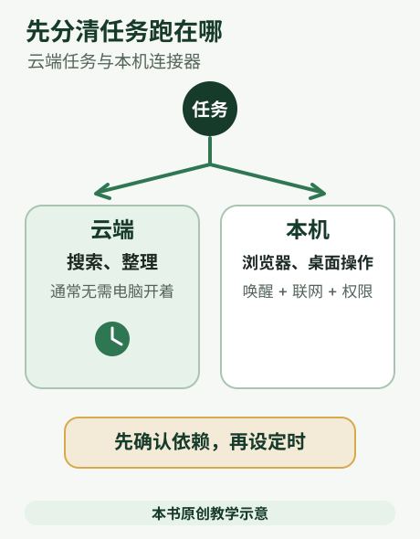

你想每周一早上自己收到一份行业资讯简报，先看看最近公开发布了什么，再决定要不要转给同事。第一版不需要自动群发，也不依赖旧对话里的记忆，只需从公开来源查找、核对、把结果留在自己的任务会话里。创建计划前，先选清楚任务在哪运行：千问办公 Web 有云端计划，桌面端有本地计划；即时通信（IM，指钉钉等聊天工具）频道还可从聊天窗口临时发起任务。

### 先选运行位置

若简报只检索公开网页、结果保存在任务会话，可优先了解 Web 云端计划；关闭浏览器或退出登录不影响已启用的 Web 任务。若要求读取电脑里的本地资料或操作桌面应用，则看桌面端计划：它由本地客户端调度，电脑睡眠或关机时不会触发。[Web 定时任务](https://docs.qwenwork.cn/web/scheduled-tasks)；[桌面端定时任务](https://docs.qwenwork.cn/desktop/scheduled-tasks)

### 先判断任务在哪运行

| 任务需要什么 | 适合先看哪条路径 | 关键边界 |
|---|---|---|
| 每周搜索公开资讯，结果留在自己的任务会话 | Web 云端定时任务 | 写明主题、时段和允许来源；不要默认云端能读电脑本地文件。 |
| 简报还要参考本地素材或用桌面连接器 | 桌面端定时任务 | 客户端负责本地调度；电脑须在执行时运行且不能睡眠/关机。 |
| 临时在手机聊天窗口问一次“今天有哪些新动态” | 已配置的 IM 频道 | 这是一次聊天触发；依赖桌面端和渠道授权，结果回到原聊天。不是定时任务，也不代表群成员获得数据权限。 |

Web 定时任务每次执行建立独立会话，不会自动继承日常聊天上下文；把固定资料、时间范围和输出要求写进指令。桌面定时任务会按该机系统时区调度，执行结果以新会话出现并消耗额度。IM 文档说明“从哪里来、回哪里去”，不同聊天窗口的上下文彼此隔离，桌面端仍是查看会话和配置的管理处。[Web 任务执行与结果](https://docs.qwenwork.cn/web/scheduled-tasks)；[IM 频道](https://docs.qwenwork.cn/desktop/im-channels)

### 材料与低风险试跑

这是原创模拟情境，不是产品实测。准备一份简报样式要求：最多五条、每条含标题/日期/来源链接/一句摘要；限定一个行业、一个观察周期和公开来源。先在个人对话里手动查一轮，检查来源是否真有新内容、链接是否支持摘要，再决定是否设每周计划。第一版只把结果留在个人任务会话里，不让系统发给群、客户或邮件收件人。若后续要连接日历、邮件或聊天工具，官方说明相关连接器需用户明确配置和授权。[连接器](https://docs.qwenwork.cn/features/connectors)

### 创建计划任务的步骤

1. **先选位置。** 公开资讯并保存到会话可先选 Web；依赖本机资料选桌面；临时从聊天问一次选 IM。Web 与桌面定时任务及会话目前相互独立。[阿里云常见问题](https://help.aliyun.com/zh/qwenwork/product-faq)
2. **手工跑通。** 在普通对话里试做一次，检查材料是否可读、时间口径是否正确、输出能否核实。复杂流程先拆小，不要直接开启高频自动运行。
3. **写清楚指令。** 包含工作内容、允许使用的资料、时间范围、输出格式、保存或发送位置。一次运行不应依赖“上周你看到的那份文件”这类模糊上下文。
4. **设置频率与时区。** 在所选端的侧栏或功能页面找到「定时任务」，按当前页面创建。 Web 页面支持一次性、间隔和周期规则等；桌面页面可通过对话描述或面板配置计划。核对下一次执行时间；桌面任务还要看电脑时区和睡眠状态。
5. **先手动执行一回。** 检查结果会话、来源、文件路径和额度消耗；启用周期前确认执行指令和收件位置。官方 Web 任务支持查看记录、停用、编辑、立即执行或删除；删除后历史执行记录仍可查看。[Web 定时任务指南](https://docs.qwenwork.cn/web/scheduled-tasks)
6. **IM 先测低风险命令。** 按桌面端 IM 频道说明连接个人聊天工具并完成授权。在本人聊天里先 @助手查询一条公开资讯，观察结果是否回到同一窗口。确认会话映射和可用数据范围；本章练习不自动转发到其他聊天窗口。

### 可直接复制的提示词

```text
请先在当前对话中试运行下面这项工作，不要创建定时任务，也不要向任何人发送消息。

任务：整理“[起止日期]”期间的[行业]公开资讯，生成供我本人阅读的简报。
资料范围：公开网页与[可选：我明确列出的附件/个人网盘文件]；不要读取或发送其他资料。
规则：只依据列明的资料；逐项标注来源和日期；未找到写“未找到”；不要推测数据或补造事实。
输出：1) 不超过五条资讯；2) 每条的发布日期、可点击原始来源和一句摘要；3) 待确认问题；4) 本次未能访问的资料。优先官方发布页；不够五条就少于五条，不要补造。
结果只保存在对应的任务会话中，供我本人检查；不要向 IM、群聊、邮件或其他对象发送。

如果我检查后说“通过”，请给我一段创建计划任务的配置草稿，明确建议运行端（Web 云端或桌面本地）、频率、时区、所需资料和执行指令。创建前再次说明执行端能否访问这些资料、电脑是否必须开机、每次任务的输出位置。初次只保存在任务会话，不添加任何对外发送动作。
```

### 预期结果与核对项

第一次手工试跑应返回不超过五条摘要、发布日期、原始链接和待确认问题。逐条点开链接核对标题与日期，确认是否属于设定的观察周期；查不到就允许简报少几条。计划启用前再查运行端、下一次执行时间、周期消耗、输出是否只留在本人会话；桌面路径还要确认电脑届时运行且未睡眠。这样第一份自动简报只供自己验收，不会未经检查流向别人。

### 出错怎么办

没有触发：Web 端检查启用状态、下一次时间和执行记录；桌面端检查客户端是否运行、电脑是否睡眠/关机、系统时区是否正确。资讯不新：把观察日期写清，逐条核对发布日期，删掉重复旧闻。找不到引用：不要补造来源，缩小范围或如实标“未找到”。IM 没回应：检查渠道绑定、授权、桌面端连接状态，以及消息是否 @到正确对象；IM 消息和桌面直接创建的任务有不同结果路径。先在个人聊天验证，不要把测试简报发到群或客户。

### 练习

写两张计划卡：一张“Web 云端每周生成个人行业资讯简报”，一张“桌面端每周读取某个本机资料夹并补充简报”。分别标出来源、运行端、时区、是否要求电脑开机、输出位置和失败处理。再从已授权的个人聊天发一条只读资讯请求，确认结果回到原窗口。第一次只保存在自己会话，能说明材料访问范围和运行位置后再启用周期任务。


<a id="task-12"></a>

## 12 换成你的岗位

前面的做法可以迁移到不同岗位。这里准备四张原创模拟任务卡，分别适合行政、门店、内容运营和培训人员。每张都给出材料、交付物和检查办法；不需要先搭系统，也不需要提供真实客户资料。

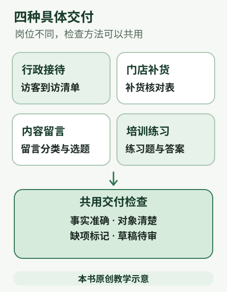

### 行政人员 给新同事写一份访客接待说明

**模拟材料。** 访客需要由接待人提前一天登记；到一层前台核对预约；不允许在生产区域拍照；临时到访先联系接待人；停车是否免费尚未确定。这里只是练习规定，不是任何真实公司的制度。

**交付要求。** 一页说明，分成到访前、到达后、注意事项、待确认四块。读者是第一次负责接待的新同事，避免“按流程办理”这类没有说清怎么做的话。

```text
请根据上面五条模拟规定，写一份新同事能照着做的访客接待说明。
不要补充证件种类、具体联系电话、停车收费或公司名称。
先交文字稿；每个步骤写谁来做、做什么。将停车问题放入待确认，不要写成免费。
再附一份三项检查清单，让接待人使用。不要发给任何人。
```

**应该看到的结果。** 提前登记由接待人完成，到达后在前台核预约；临时访客先联系接待人；拍照限制明确。停车一项应留待确认。检查清单可以核“预约是否完成、接待人是否知情、访客是否知道限制”，不能凭空增加收费凭证要求。

**过关标准。** 请一位没有看过原材料的人复述到访步骤。如果他仍需问“找谁、先做什么”，就补足表达；如果材料没提供答案，明确写成待补事项。

### 门店人员 做一张补货提醒表

**模拟库存。** 纸杯现存 24、提醒线 30；纸袋现存 40、提醒线 20；标签现存 9、提醒线 10；包装盒现存 15、提醒线 15。提醒规则：现存数量小于提醒线时列入提醒；等于提醒线先观察。提醒线是本练习人为设定，不代表真实采购标准。

```text
请根据这四种模拟物料制作一张补货提醒表。
规则是“现存数量小于提醒线”才提醒，等于时标“观察”，大于时标“暂不提醒”。
请列物料、现存、提醒线、判断理由。只做提醒，不生成订单，不联系供应商，不自行推算采购量。
```

**核对答案。** 纸杯和标签需要提醒；纸袋暂不提醒；包装盒处于观察状态。没有销量、交货周期和采购单位，不能算出真实应买多少。把“需要提醒”直接写成“立即采购 100 件”就越过了材料范围。

可以把结果复制到自己的表格中，也可以要求生成可编辑文件。正式使用时应补齐真实库存口径、盘点时间、安全库存规则和审批人。更新表格不会自动改变仓库库存，也不等于已经向供应商下单。

### 内容运营 从反馈里找下周要讲什么

**模拟留言六条。**“不会上传表格”；“想看手机怎么打开文件”；“表格上传后数字变成文字”；“导出后字体变了”；“希望有一份可复制通知”；“手机上下载按钮找不到”。

任务是分类整理留言，提出三个可做的选题，每个选题指回具体留言。不是推断用户画像，也不是预测爆款播放量。

```text
请把这六条模拟留言按问题主题归类，每条只归入一个主要类别，保留原话。
再提出三个下周教程选题，说明分别回答了哪些留言。
不得补出用户年龄、职业、付费意愿或预计播放量。重复问题可以合并，但要保留对应留言编号。
最后给出每篇教程需要准备的演示材料。
```

**可以接受的结果。** 上传与数据识别、手机文件操作、文件导出与可复用文稿都能成为方向；分类方式可以不同，只要六条都保留、理由可解释。两条手机相关留言不代表“大部分用户只用手机”。选题应先解决已收到的问题，不靠虚构人群结论支撑。

### 培训人员 把一段规定变成练习题

**模拟规定。** 差旅申请先说明出差目的和日期；住宿费用需保留凭证；超出标准的事项先申请审批；报销具体时限另行通知。本段没有金额标准和报销截止天数。

```text
请依据这段模拟规定，为新员工制作三道情境练习题，每题附答案和原文依据。
题目分别考查出差前准备、凭证保留、超标准处理。
不要编造住宿限额或报销天数；遇到未规定的事情，正确答案应包含“向负责人确认”。
用普通中文，每题不超过100字。仅作内部教学草稿。
```

**过关标准。** 题目和答案都能被原规定支持，不产生新制度；至少有一个情境让学员识别“材料没有给出答案”。培训材料的错误会被多人重复学习，因此核对答案与核对正文同样必要。

### 把任务卡换成真实工作前

保留交付物和核对方法，替换模拟材料。先确认资料允许在所选账号与模型中使用；为原文件留副本；先小批量做一份；请实际使用者看能否照着做。等一份成品通过，再考虑做成技能或定时任务。

这四个练习主要使用整理、写作与表格处理能力。千问办公的官方 [内容生成](https://learn.qwenwork.cn/docs/tasks/content-generation.html) 和 [数据分析](https://learn.qwenwork.cn/docs/tasks/data-analysis.html) 页面说明了对应能力方向；本篇的业务规则、素材和答案全部由本书为教学原创编写。


<a id="task-13"></a>

## 13 卡住时按顺序排查

AI 工具有时会卡住、找不到文件、提示无权限或给出偏题结果。先按顺序排查账号、网络、权限、用量和任务指令。记录错误时不要附密码、验证码或客户资料。

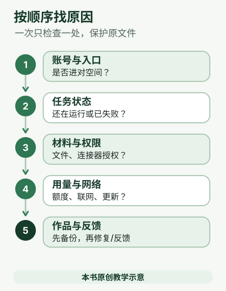

### 第一步：确定自己在哪个账号和入口

先看页面或桌面端当前登录的是哪个账号、哪个工作空间。千问办公有个人空间和组织空间；企业账号可能由管理员设置权限和用量。不同入口的功能也可能不同：官方 FAQ 说明，浏览器自动化和本地文件操作仅桌面客户端支持，部分网页制作能力先在 Web 或钉钉端提供；桌面历史任务保存在本机，Web 与桌面端的定时任务和会话目前不一定互通。

如果同事看得到某个按钮，你却没有，先别认定是故障。检查是不是个人/企业空间不同、是不是登录了另一个账号、当前端是否支持、管理员是否开放了功能。可对照[常见问题](https://help.aliyun.com/zh/qwenwork/product-faq)和[桌面端使用链路](https://help.aliyun.com/zh/qwenwork/desktop-usage)。

### 第二步：看任务是否还在运行

复杂任务需要时间。先看任务状态和最近的执行步骤，避免连续点击“重新运行”造成重复文件或重复发送。如果任务停在读取文件、联网或连接器步骤，记下具体提示；遇到登录、扫码或验证码页面，按官方说明由本人接管完成。若任务结果已经生成但找不到，检查任务对应会话、文件保存位置和「我的网盘」等页面。

新开一条任务时，把目标写得小一些：先让它“读取一个文件并列出三条摘要”，确认有效后再逐步增加步骤。若它误解了任务，补充一个具体例子和明确边界，比只说“做得更好”更有用。

### 第三步：检查连接器和系统权限

提示“找不到工具”时，检查需要的连接器是否已启用、账号是否授权、服务本身是否需要再次登录。刚开启或关闭连接器后，官方文档建议新建任务再试；老对话可能仍沿用旧的工具列表。桌面端读取本地文件或控制界面，也需要相应的系统权限。只给当前任务所需权限，并确认授权弹窗里的应用名称和访问范围。

浏览器操作慢，可能与网络、页面复杂度和实时识别有关。先给出明确网页地址，减少跨页面跳转；把大任务拆成几个步骤。如果当前功能提供 MCP 接入，遇到异常先检查配置内容是否完整、网络是否可用、外部服务是否已授权，以及密钥是否仍有效。不要一开始就删除连接器或重装；这可能清掉已有配置。确需重新配置时，先查看该服务官方说明；保留非敏感设置，并只在官方密钥输入位置重新授权，不要导出或粘贴密钥。参考[连接器排错](https://help.aliyun.com/zh/qwenwork/desktop-connectors)和[系统设置及权限](https://help.aliyun.com/zh/qwenwork/system-settings)。

### 第四步：检查积分、套餐和限制

如果任务因额度不足停止，打开个人头像或设置里的用量页面，看当前积分、到期时间、订阅状态和用量明细。积分、套餐价格、赠送活动和功能额度会变化，个人版与企业版也不同，别依赖旧截图或网上的过期价格。最终价格及有效期以购买确认页为准；企业成员可以询问管理员是否还有组织共享额度或个人上限。

实用做法是先让 AI 处理一小段样本，观察实际消耗，再决定是否扩大范围或购买。不要把“每日登录积分”“新用户赠送”等限时权益当作固定额度；也不要误以为提高个人上限就增加了组织的实际积分。官方信息见[个人版权益](https://help.aliyun.com/zh/qwenwork/personal-benefits)、[套餐升降级策略](https://help.aliyun.com/zh/qwenwork/plan-change-policy)和[企业积分管理](https://help.aliyun.com/zh/qwenwork/cn-enterprise-standard-credits)。

### 第五步：网络、更新和端差异

若网页打不开或工具一直等待，先确认网络可访问官网，刷新页面或重新登录；切换网络前先保存当前提示和未交付内容。桌面客户端可到设置检查版本，按照应用内提示更新。更新后若界面名称变化，以当前页面的说明为准。官方桌面使用指南给出支持平台和系统版本，遇到启动问题先核对系统是否符合要求，再查产品帮助中心，不要下载来历不明的安装包。

企业环境可能使用代理、组织策略或额外的安全管控；个人设置无法绕过管理员策略。若问题只发生在企业账号或某条连接器上，向管理员说明入口和错误，不要私自改动组织配置。

### 第六步：保护作品，明确删除范围

排错不等于清理数据。重要任务产物先下载或另存一份，再考虑删除旧记录。桌面端“清理工作环境文件”不会删除对话记录和工作产物；归档任务可恢复，也可单独彻底删除。Web 定时任务删除后会停止后续触发，但过去的执行记录和会话仍可能保留。账号注销不可逆，先导出并备份需要保留的资料。

误删后不要假定千问办公有适用于所有文件的统一回收站或版本恢复。先停止后续操作，确认文件原来保存在哪个位置，再查看该应用或存储位置是否明确提供恢复/历史功能；找不到经过说明的恢复入口时，联系管理员或官方支持。意识功能导出的备份只包含意识文件，不能替代对话、云盘、网页数据库等资料的单独备份。网页删除可能连同关联数据库一起释放且不可恢复。相关说明见[系统设置](https://help.aliyun.com/zh/qwenwork/system-settings)、[意识与备份](https://help.aliyun.com/zh/qwenwork/awareness)、[网页管理与删除](https://help.aliyun.com/zh/qwenwork/my-webpage-1)。

### 第七步：记录并反馈

如果还不能解决，记录发生时间、所在端（网页/桌面/钉钉）、账号空间、你想完成什么、实际出现什么，以及复现步骤。需要时附错误提示截图，遮住文件内容、手机号和客户信息。打开[问题反馈](https://docs.qwenwork.cn/feedback)可通过 AI 客服提交；按[提问指南](https://docs.qwenwork.cn/feedback/how-to-ask)，进入发生问题的会话，在会话信息或问题反馈页面查看并复制 User ID（账号编号）和 Session ID（本次会话编号）。如果暂时找不到，提供问题发生时间和对应会话截图，由工作人员协助查询。不要提交密码、验证码、访问令牌或密钥。企业管理员还可按问题类型查看[日志审计](https://help.aliyun.com/zh/qwenwork/enterprise-ultimate-audit-logs/)；不同日志有各自的查询时间范围，问题发生后尽早记录。

### 常见现象快速对照

- **找不到文件：** 确认文件在本机还是云盘；检查桌面端是否有该目录访问权限；给出完整文件名和位置。
- **回答不准确：** 确认输入材料是否最新、任务口径是否清楚；要求列出依据，再逐项对照原文。
- **连接器不能用：** 检查连接状态和登录授权，随后新开任务；不要把密码复制到对话。
- **任务迟迟不结束：** 先看运行记录和具体卡点，不要重复触发；按步骤缩小任务后再试。
- **积分不够：** 查看用量、到期时间和账号类型，按实时购买页判断；企业账号问管理员。
- **误删或误改：** 立即停止后续操作，确认原文件所在的应用或位置，并只使用该处明确提供的恢复功能；若没有找到经过说明的入口，联系管理员或官方支持。此前另存的备份可用于恢复。若信息已经发出，尽快联系接收方处理。

排错时先保护资料，再定位问题。重要数字、事实和对外成果都要人工复核。


<a id="task-14"></a>

## 14 七个二十分钟小挑战

这七项练习可以任选，也可以调换顺序。每项只练一件具体小事：改通知、找证据、检查附件、改一段话、核算表格、试一次只读任务、整理交接材料。建议每项留约 20 分钟，材料用公开内容或自己编的样例。练习的目标是拿到一份可核对的小成果，不要求一次学会所有按钮。

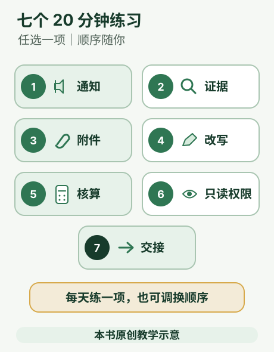

开始前准备一份不含个人信息的短文、一份公开网页或官方说明、一份可阅读的小文件、一段待修改文字、一张几行的练习表格和一个空文件夹。不要用客户名单、密码、验证码、密钥或公司未公开资料练习。千问办公桌面端在本机保存部分历史任务，但云端模型、云端任务和连接器仍可能处理你提交的内容；“在本机运行”不等于整个处理过程只在本机。见[千问办公隐私政策](https://terms.alicdn.com/legal-agreement/terms/privacy_policy_full/20260709092132640/20260709092132640.html)和[桌面端使用链路](https://help.aliyun.com/zh/qwenwork/desktop-usage)。

### 挑战一：把一则通知改得一眼能看懂

**输入：** 一段你自己编的活动通知，包含标题、时间、地点和参加方式。可以故意写得啰嗦，但所有事实都要确定。

**提示词：**“请把下面的通知改成适合发给社区居民的简明版本。保留标题、时间、地点和参加方式，不添加费用、名额或报名截止时间。先给我修改稿，并列出你改了哪些表达。原文：……”

**成果：** 一段清楚的通知和修改说明。

**验收：** 逐项对照原文，日期、地点和参加方式没有变化，也没有新增条件；朗读一遍，确认没有容易误会的句子。

### 挑战二：为一个结论找到证据

**输入：** 一个小问题，例如“这项服务目前支持哪些文件格式？”，以及一份官方帮助页面或链接。

**提示词：**“请只根据我提供的官方页面回答问题。列出结论、对应的小标题或原文关键词、页面链接和仍不确定的地方。页面没有说明的内容写‘未找到’，不要猜。”

**成果：** 一条带出处的答案和待确认项。

**验收：** 自己打开来源，检查标题、适用对象和页面内容确实支持这条答案。若页面打不开或没写到，就记录为未知，不用搜索摘要补空白。

### 挑战三：检查一个附件有没有回答问题

**输入：** 一份公开、可阅读的 PDF 或 Word 文件，以及三个可以在文件里查到的问题。

**提示词：**“请先告诉我你读取到的文件名。回答这三个问题，并分别标出文件页码、标题或可搜索关键词。文件没有写到的答案写‘未说明’。不要用常识补全。”

**成果：** 三条问答和文件定位。

**验收：** 在原文件找到对应内容；页码或关键词能帮助你复查。若定位不准确，就先让它指出相关段落，不要直接采用答案。

### 挑战四：修改一段话，但不改变原意

**输入：** 一段自写的说明文字，注明读者是谁，例如第一次参加活动的人。

**提示词：**“请把这段话改得更短、更容易读，面向第一次参加活动的人。保留原有事实和条件，不增加承诺。先给修改稿，再逐条列出删改点；不确定含义的句子先提问。”

**成果：** 修改稿和删改点清单。

**验收：** 对照原文确认条件、责任和时间没有变化。若它删掉了关键限制，把原句补回并明确指出原因。

### 挑战五：核算一张小表格

**输入：** 自己编的 5 至 10 行数据，列出日期、项目和金额，并说明单位。不要用真实账目练习。

**提示词：**“请先检查行数、空白和金额格式，再按我给出的规则计算总和和最高值。列出参与计算的行及公式，不推测数字背后的原因。单位是元。”

**成果：** 合计、最高值、计算口径和异常项。

**验收：** 用计算器或表格公式重新计算，确认总和与最高值。AI 给出的结果不要未经核对用于报销、付款或正式财务决定。

### 挑战六：练习只读任务，并检查权限

**输入：** 一个无敏感信息的练习文件。先检查当前任务是否需要桌面文件权限或连接器；不需要的就不要开启。

**提示词：**“只读取这个文件并给我三条摘要。本次不要改动或另存原文件，不要连接邮箱或其他账号，不要发送或删除内容。完成后列出你读取了什么、生成了什么。”

**成果：** 三条摘要和本次使用范围的记录。

**验收：** 确认原文件没有变化，并查看任务过程及连接器设置。系统权限决定工具可能触达的范围；提示词只是说明本次任务想做什么，并不能隔离文件或限制系统权限。只开启确有需要的权限，重要操作仍由你检查。参见[系统设置](https://help.aliyun.com/zh/qwenwork/system-settings)和[连接器](https://help.aliyun.com/zh/qwenwork/desktop-connectors)。

### 挑战七：整理一份方便交接的材料包

**输入：** 前面任一项已经核对过的成果、它的来源，以及一条尚未解决的问题。不要放入秘密或不该共享的信息。

**提示词：**“请帮我整理这项工作的交接清单：最终文件名称、文件用途、依据来源、已核对内容、尚待确认事项、下一步负责人（如果材料没提供就写待填写）。不要发送或发布文件。先列出拟整理的文件和清单给我检查。”

**成果：** 核对过的最终文件、来源说明和待办清单；保存到你自己选择的位置。

**验收：** 每项成果能说明来源和状态；未确认内容清楚标出；文件能打开；没有把客户资料或访问密钥误放进材料包。若要交给他人，按组织规则确认分享对象和权限后再操作。

### 做完后留下一张检查卡

每做完一项，记下四件事：输入是什么、成果放在哪里、你核对了什么、还有什么未知。下次遇到相似任务时，可以复用这张检查卡或自己保存的提示词；价格、积分、功能按钮和可用端可能变化，操作时看当前产品页面。需要提交问题时，提供发生时间、预期和实际结果、复现步骤以及对应会话信息；不要提交密码、验证码或访问密钥。官方[问题反馈](https://docs.qwenwork.cn/feedback)说明可通过 AI 客服反馈，[提问指南](https://docs.qwenwork.cn/feedback/how-to-ask)说明如何找到 User ID 和 Session ID，以及应避免提交哪些敏感信息。


<a id="task-15"></a>

## 15 登录与常用词

不必背完这些内容再开始。看到不认识的词，回来查一项即可；能把任务交清楚、能检查结果，比会说术语更有用。

### 三个入口 怎么选

**网页端。** 打开 [千问办公官网](https://qwenwork.cn/)，进入使用网页端的入口。官方 Web 流程列出钉钉扫码或中国大陆手机号登录。先确认网址，再完成本人登录和验证码操作。适合初次体验、临时设备和主要依靠上传资料的任务。

**桌面端。** 需要处理本机文件、使用电脑操作等能力时，从 [官方下载页](https://qwenwork.cn/download) 按当前操作系统下载。只按官方页面选择，不从搜索广告或第三方安装包下载。安装、登录后按正在使用的功能授予必要权限。首次练习可以单独建一个“千问练习”文件夹，只放模拟材料和副本。

**钉钉入口。** 官方说明支持在钉钉中进入千问办公；不同端或版本的导航位置可能不同。找不到时，先更新钉钉、核对所在组织和账号权限，再查官方指引或询问管理员。连接钉钉数据和仅从钉钉打开产品，是不同的事情。

官方依据：[快速开始](https://docs.qwenwork.cn/getting-started/usage-entry) · [网页端流程](https://docs.qwenwork.cn/getting-started/basic-workflow) · [桌面端流程](https://docs.qwenwork.cn/getting-started/desktop-workflow)

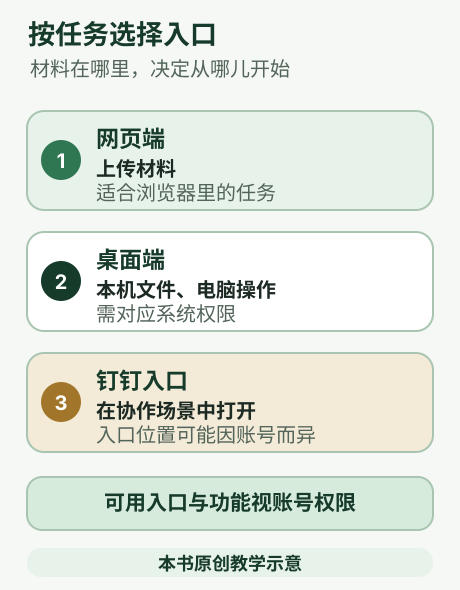

登录后核对自己进入的是个人空间还是企业空间。企业空间的功能、可用模型和资源可能由管理员控制。不要把“自己能登录”当成“已经有全部功能”。桌面与网页也不是每一项历史、设置或定时任务都相同；按功能对应的说明查看。

### AI 和千问办公是什么关系

**AI 模型。** 可以把它理解成负责理解和生成内容的部分。它根据当前看到的文字、图片和其他资料给出回答，可能理解错、记错或编出不实细节。模型有能力边界，并不等于事实数据库。

**智能体 Agent。** 理解任务后，还能在授权范围内调用工具、观察结果并继续操作的系统。就像协助完成工作的同事，需要材料、工具和权限。能动手不会让它天然正确，也不代表每次操作都能撤销。

**工具。** 做一个具体动作的能力，例如读取文件、搜索资料、生成表格。AI 说“我将读取”只是计划；需要看实际结果，才能知道是否读到了。

**系统指令。** 产品或组织给 AI 的基本工作规则，例如处理资料的范围和交互要求。你写“请先核对数字”是任务要求；两者共同影响行为，但文字规则不能替代系统权限。

**上下文。** 这一次处理时能够看到的材料，包括当前任务、前面的对话和加入的文件。想象桌面上摊开的文件：没放上来、读不清或已经超出可用范围的内容，不应指望它凭空知道。

**Token。** 模型处理内容时用的计量单位，可以粗略理解成文本碎片。一个汉字不一定等于一个 Token。普通读者不必手算；资料太长时，优先缩小任务范围和选取相关材料。

**幻觉。** AI 把没有依据的内容说得很肯定。典型表现是编造网址、人物职位、活动安排或统计原因。要求提供来源，并亲自核查，能够发现许多这类问题。

### 工作台 扩展和文件

**工作台。** 为某类工作准备的界面，例如写作、幻灯片。它不一定与通用对话使用相同的文件和导出路线。桌面写作工作台官方说明以 Markdown 文件组织内容，可编辑并导出 PDF；想要 Word 时应明确要求可编辑的 `.docx` 交付，不能把预览或 PDF 当成 Word。[写作工作台](https://docs.qwenwork.cn/workspaces/writing)

**技能 Skill。** 做一类事情的方法说明和配套材料。例如通知怎么写、数据先检查什么。技能帮助重复工作遵循同样方法，不是另一个模型。

**专家套件。** 围绕某个行业或岗位组合的一套能力和工作方法。名称里有“专家”，不表示结果经过有资质人员审核；正式业务判断仍需要相应负责人。

**连接器。** 让千问办公访问另一项服务的入口。连接后能看什么、改什么，由授权范围和服务实际能力决定。

**MCP。** 连接外部工具与资料的一种标准协议。可以先理解成约定好的接口规格；协议本身不会替你取得账号权限。没有业务需要的普通读者无需自行配置服务器。

**意识或记忆。** 产品用来保存协作偏好和部分工作上下文的功能。它与放文件的网盘、用于查资料的知识库不同；记住了内容，也不保证内容仍然有效。

这些产品功能的进一步依据见 [技能](https://docs.qwenwork.cn/features/skills)、[专家套件](https://docs.qwenwork.cn/desktop/expert-kits)、[连接器](https://docs.qwenwork.cn/features/connectors) 和 [意识](https://docs.qwenwork.cn/desktop/memory)。

**积分和额度。** 可以理解成账号还能使用多少任务资源的指标。不同模型、任务和套餐的计算方式可能不同；积分到期、额外服务费用和使用限制要看当前账号页面。余额够不够与某项功能有没有开放，是需要分别核对的问题。

**即时通信 IM。** 就是钉钉、飞书等聊天工具的统称。在聊天里发起任务，不代表千问办公已经能读取该工具中的全部资料；先检查渠道配置和授权。

### 常见文件名后缀

| 看见的后缀 | 一句话说明 | 检查时注意 |
| --- | --- | --- |
| .docx | 常见的可编辑 Word 文档 | 下载后确认能修改文字和表格 |
| .xlsx | 常见的 Excel 工作簿 | 核公式、工作表、数字和单位 |
| .csv | 以文字保存的一张简单表 | 不保留复杂排版；检查分列和中文 |
| .pptx | 常见的 PowerPoint 演示文件 | 用播放软件打开看字体和位置 |
| .pdf | 便于阅读或打印的定稿形式 | 通常不如源文件方便继续编辑 |
| .md | Markdown 纯文字文稿 | 标题等用简短符号表示，适合继续修改 |
| .html | 可以由浏览器打开的网页文件 | 本地文件不等于已发布的公开链接 |
| .zip | 把多个文件装在一起的压缩包 | 解压后看文件是否完整 |

预览画面、源文件、下载文件和公开网址是四种不同的东西。交付时把它们说清楚，能减少很多“看到了却用不了”的问题。

### 官方资料 去哪里找

下列是本书重点使用的官方入口，查阅日期均为 2026 年 10 月 23 日。正文另有直达对应功能页面的链接。若链接内容更新，以当前页面、实际账号和组织规定为准。

- [千问办公官网](https://qwenwork.cn/)：入口、下载、当前价格与企业服务。
- [千问办公帮助文档](https://docs.qwenwork.cn/)：功能说明、安装、权限、工作台和操作路径。
- [官方学习站 职场 AI 三千问](https://learn.qwenwork.cn/)：具体任务示例与场景演示。
- [阿里云帮助中心 千问办公简介](https://help.aliyun.com/zh/qwenwork/qwenwork-intro)：中国版功能与帮助信息。
- [个人版权益](https://docs.qwenwork.cn/benefits/personal)：当前套餐、积分与购买规则。
- [服务协议](https://terms.alicdn.com/legal-agreement/terms/b_end_product_protocol/20260708175856831/20260708175856831.html) 与 [隐私政策](https://terms.alicdn.com/legal-agreement/terms/privacy_policy_full/20260709092132640/20260709092132640.html)：使用边界、数据处理与相关规则。

**本版验证范围。** 本书核查了公开官方资料，独立编写并计算了模拟练习答案，检查了本书网页与配图。没有登录读者的千问办公账号，没有验证每个套餐和设备上的实际操作，也没有替读者发送消息、购买套餐或发布网页。正式使用时先用允许上传的小样本跑一次，再检查实际交付物。


### 官方帮助页中的界面示例

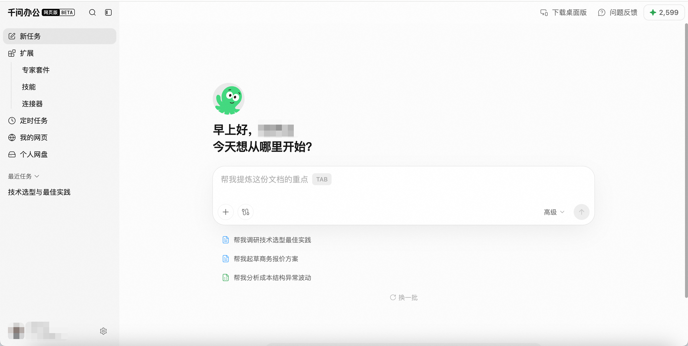

图源：[千问办公官方 Web 使用流程](https://docs.qwenwork.cn/getting-started/basic-workflow)，查阅于 2026 年 10 月 23 日。这是官方示例图，实际按钮和空间以自己的版本为准，并非本书账号实测截图。
